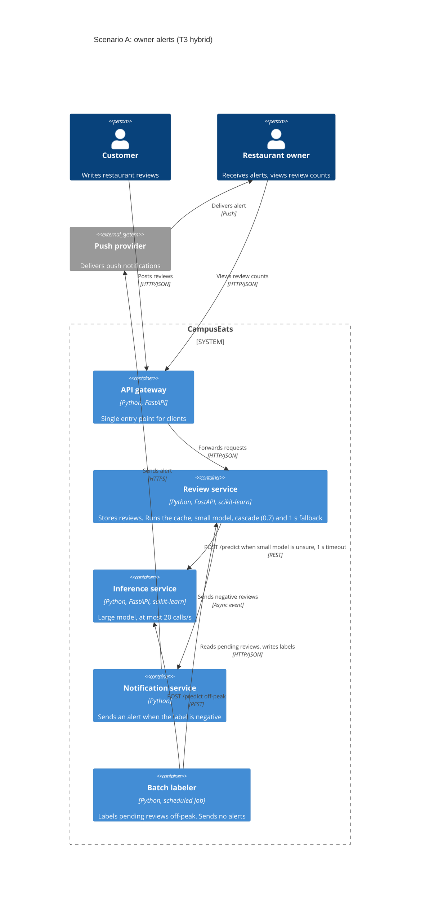

# Task 4: Deployment topologies and trade-offs

**Name / ชื่อ:** นาย ชินนวัตร แก้วฉิม

**Student ID / รหัสนิสิต:** 6870062321

This is **individual work**: each student completes and submits their own copy, in their own fork.

*งานนี้เป็น**งานเดี่ยว** นิสิตแต่ละคนทำและส่งงานของตัวเอง ใน fork ของตัวเอง*

**Scenario (A, B or C) / Scenario ที่เลือก:** A. Owner alerts (เลขท้ายรหัสนิสิตเป็น 1 ซึ่งเป็นเลขคี่)

Choose **one** scenario below. If the last digit of your student ID is odd, take A or B; if it is even, take B or C. Use your measurements from Tutorial 6 as evidence: cite run names from `results/runs.csv`. Answer in Thai or English.

เลือก scenario **หนึ่ง** ข้อด้านล่าง ถ้าเลขตัวสุดท้ายของรหัสนิสิตเป็นเลขคี่ ให้เลือก A หรือ B ถ้าเป็นเลขคู่ ให้เลือก B หรือ C ใช้ผลการวัดจาก tutorial ที่ทำไปเป็นข้อมูลอ้างอิง โดยอ้างชื่อ run จาก `results/runs.csv` จะตอบเป็นภาษาไทยหรือภาษาอังกฤษก็ได้

Facts that hold in every scenario / ข้อเท็จจริงที่ใช้กับทุก scenario:

- The large model serves at most **20 calls per second** (4 calls at once × about 200 ms each), and every call costs money.

  *large model รับได้สูงสุด **20 calls ต่อวินาที** (พร้อมกัน 4 calls × ประมาณ 200 ms ต่อ call) และทุก call มีค่าใช้จ่าย*
- The small model is fast and cheap enough to run anywhere, including inside the review service or on a kiosk, but it is much less accurate on its own.

  *small model เร็วและถูกพอที่จะรันที่ไหนก็ได้ รวมถึงภายใน review service หรือบน kiosk แต่ถ้าใช้ตัวเดียวจะแม่นน้อยกว่ามาก*

## Scenarios

**A. Owner alerts.** When a customer posts a negative review, the restaurant owner gets a push notification within **2 seconds**. At the lunch peak, CampusEats receives **40 reviews per second**. A missed alert is acceptable, but a wrong alert (for example, "your customer is unhappy" when they are happy) makes owners stop trusting alerts and, in the end, ignore them.

*เมื่อลูกค้าโพสต์รีวิวเชิงลบ เจ้าของร้านจะต้องได้รับ push notification ภายใน **2 วินาที** เวลาช่วงพีคตอนเที่ยง CampusEats ได้รับรีวิวจำนวน **40 รายการต่อวินาที** การพลาด alert ไปบ้างนั้นยอมรับได้ แต่ alert ที่ผิด (เช่น "ลูกค้าไม่พอใจ" ทั้งที่จริงๆ แล้วพอใจ) จะทำให้เจ้าของร้านไม่เชื่อถือและเลิกสนใจ alert ในที่สุด*

**B. Canteen kiosk.** A tablet in each canteen lets students leave a review on the spot. However, the canteen Wi-Fi is poor: the tablets lose their connection several times a day, for minutes at a time. The system must accept every review, even while a tablet is offline. Restaurant owners need the labels **by the end of the day**.

*มี tablet ในแต่ละโรงอาหารให้นิสิตรีวิวได้ทันที อย่างไรก็ดี การเชื่อมต่อ Wi-Fi ในโรงอาหารไม่ดี ทำให้ tablet หลุดการเชื่อมต่อวันละหลายครั้ง ครั้งละหลายนาที ระบบจะต้องรับรีวิวได้ทุกรายการแม้ขณะที่กำลัง offline อยู่ และเจ้าของร้านต้องการ label **ภายในสิ้นวัน***

**C. Weekly report.** Restaurant owners want a weekly sentiment report. Nothing in producing this report has to be real-time. **Accuracy matters most** and **cost must be minimal**.

*เจ้าของร้านต้องการรายงาน sentiment รายสัปดาห์ ไม่มีอะไรที่จะต้องทำแบบ real-time ในการออกรายงานนี้ ความแม่นยำ **(accuracy) สำคัญที่สุด** และ **ค่าใช้จ่ายต้องน้อยที่สุด***

## Topologies and patterns to choose from / Topology และ pattern ที่เลือกใช้ได้

| | Topology | Where the model runs / โมเดลรันที่ไหน |
|---|---|---|
| T1 | Model as a service, synchronous | Inference service, called for each review (today's baseline) *inference service ถูกเรียกทุกรีวิว (baseline ของวันนี้)* |
| T2 | Model as a library | Inside the review service, or on the device *ภายใน review service หรือบนอุปกรณ์* |
| T3 | Hybrid | Small model locally, large model as a remote service *small model รันในเครื่อง large model เป็น remote service* |
| T4 | Asynchronous / batch | Reviews are queued (broker, W10) or stored, and scored later in bulk *รีวิวถูกเข้าคิว (broker, W10) หรือเก็บไว้ แล้วติด label ทีหลังเป็นชุด* |

Combine one topology with any of the patterns from Tutorial 6: **fallback**, **cascade** and **cache**.

*เลือก topology หนึ่งแบบ แล้วผสมกับ pattern จาก Tutorial 6 ได้ตามต้องการ: **fallback**, **cascade** และ **cache***

## 1. Quality requirements

The three most important quality requirements for your scenario, each with a number where possible.

*quality requirements ที่สำคัญที่สุด 3 ข้อของ scenario ที่เลือก ระบุตัวเลขเมื่อทำได้*

| # | Quality | Requirement |
|---|---|---|
| 1 | Accuracy | label ที่ใช้ตัดสินใจส่ง alert ต้องถูกอย่างน้อย 90% ยอมพลาด alert ได้บ้าง เพราะ alert ที่ผิดทำให้เจ้าของร้านเลิกเชื่อ |
| 2 | Performance | รีวิวเชิงลบต้องถึงเจ้าของร้านภายใน 2 วินาที ที่ 40 รีวิวต่อวินาที ถ้าติด label ไม่ทันภายใน 1 วินาทีให้ถือเป็น pending และไม่ส่ง alert |
| 3 | Capacity / Cost | ช่วงพีคต้องใช้ large model ไม่เกิน 20 calls ต่อวินาที และยิ่งน้อยยิ่งดี เพราะทุก call มีค่าใช้จ่าย |

## 2. Design / การออกแบบ

Your topology, the patterns you add, and a container-level diagram (C4 level 2). The C4 diagram must be written in Mermaid.

*topology ที่เลือก pattern ที่เพิ่ม และ diagram ระดับ container (C4 level 2) เขียนด้วย Mermaid*

**Topology: T3 Hybrid.** small model และ cache รันใน review service ส่วน large model เป็น remote service

**Patterns ที่เพิ่ม:**
- **Cascade (threshold 0.7):** small model ตอบเองเมื่อ confidence ≥ 0.7 ที่เหลือจึงส่งไป large model
- **Cache:** คำตอบที่เคยได้จะถูกเก็บไว้ รีวิวซ้ำจึงไม่ต้องเรียกโมเดล
- **Fallback (timeout 1 วินาที):** ถ้า large model ไม่ตอบทัน รีวิวจะถูกเก็บเป็น `pending` และไม่ส่ง alert batch job จะมาติด label ทีหลังเพื่อให้จำนวนรีวิวของร้านครบ

## 3. Evidence / หลักฐาน

Which runs support your choice? Show the numbers and, for scenario A, the capacity arithmetic: how many large-model calls per second does your design need at the peak?

*run ไหนที่สนับสนุนการตัดสินใจของนิสิต ให้นิสิตแสดงตัวเลขประกอบ และสำหรับ scenario A ให้นิสิตแสดงการคำนวณ capacity ด้วย เพื่อแสดงว่าในช่วงพีคนั้น design ของนิสิตต้องใช้ large model กี่ calls ต่อวินาที*

| Run | What it shows / แสดงอะไร |
|---|---|
| `t2-0.6` | cascade 0.6 ใช้ large 38% แต่ accuracy 91.5% ต่ำสุดในกลุ่ม |
| `t2-0.7` | cascade 0.7 ได้ accuracy 93.0% แต่ใช้ large 53% ซึ่งเกิน capacity ถ้าไม่มี cache |
| `t2-0.8` | cascade 0.8 ใช้ large 64% ซึ่งเกิน capacity ชัดเจนถ้าไม่มี cache |
| `t4-a-0.7-cache` | design ที่เลือก: accuracy 93.0%, large 38%, cache hits 35%, p50 7 ms, p95 531 ms |
| `t4-a-0.7-cache-chaos` | large model ค้าง 10%: errors 0, pending 15, p95 1005 ms ยังอยู่ในกรอบ 2 วินาที |

**Capacity ที่พีค 40 รีวิวต่อวินาที** (large model รับได้ 20 calls/s จึงใช้ได้ไม่เกิน 50%):

| Design | Large calls | Calls/s ที่พีค | ผล |
|---|---|---|---|
| ไม่มี cascade (`t0-large`) | 100% | 40 × 1.00 = 40.0 | เกิน 2 เท่า |
| Cascade 0.8 (`t2-0.8`) | 64% | 40 × 0.64 = 25.6 | เกิน |
| Cascade 0.7 (`t2-0.7`) | 53% | 40 × 0.53 = 21.2 | เกินเล็กน้อย |
| Cascade 0.6 (`t2-0.6`) | 38% | 40 × 0.38 = 15.2 | พอ แต่ accuracy ต่ำสุด (91.5%) |
| Cascade 0.8 + cache (`t3-cache`) | 40% | 40 × 0.40 = 16.0 | พอ ใช้ 80% ของ capacity |
| **Cascade 0.7 + cache (`t4-a-0.7-cache`)** | **38%** | **40 × 0.38 = 15.2** | **พอ ใช้ 76% ของ capacity** |

**ข้อจำกัดของหลักฐาน:**
- `loadtest.py` ส่งรีวิวพร้อมกันครั้งละ 10 รายการ จึงยังไม่ได้ทดสอบโหลด 40 รีวิวต่อวินาทีจริง ตัวเลข capacity ด้านบนเป็นการคำนวณจากสัดส่วน large calls
- `accuracy` ไม่ได้วัด alert ที่ผิดโดยตรง เป็นแค่ตัวแทนของ precision
- วัดบน topology T1 ไม่ใช่ T3 จริง จำนวน large calls ควรเท่ากันเพราะ logic เหมือนกัน แต่ latency จริงยังต้องวัดอีกครั้ง
- ยังไม่ได้วัดเวลาของ push provider
- ข้อมูลทดสอบเป็นข้อมูลสังเคราะห์ที่ข้อความซ้ำกันเยอะ cache hits จริงอาจต่ำกว่านี้

## 4. ADR

Use the ADR format from W5.

*ใช้รูปแบบ ADR จาก W5*

**Title:** ใช้ Hybrid topology กับ cascade 0.7, cache และ fallback สำหรับ owner alerts

**Status:** Proposed

**Context:** เจ้าของร้านต้องได้ alert รีวิวเชิงลบภายใน 2 วินาที ช่วงพีคมี 40 รีวิวต่อวินาที แต่ large model รับได้แค่ 20 calls ต่อวินาทีและทุก call มีค่าใช้จ่าย จึงส่งทุกรีวิวไป large model ไม่ได้ (`t0-large` ต้องใช้ 40 calls/s) ส่วน small model ตัวเดียวก็แม่นไม่พอ (`t0-small` accuracy 72.5%) การพลาด alert ยอมรับได้ แต่ alert ที่ผิดทำให้เจ้าของร้านเลิกเชื่อ

**Decision:** ใช้ T3 Hybrid โดยรัน small model และ cache ใน review service และเรียก large model เป็น remote service เมื่อ confidence ของ small model ต่ำกว่า 0.7 ตั้ง timeout 1 วินาที ถ้าหมดเวลาให้เก็บรีวิวเป็น `pending` และไม่ส่ง alert ส่ง alert เมื่อ label เป็น `negative` และให้ batch job ติด label รีวิว pending ช่วงนอกพีค

**Consequences:**
- Positive: ใช้ large model 15.2 calls/s ที่พีค ซึ่งอยู่ใน capacity และถูกกว่าการส่งทุกรีวิว 62% (`t4-a-0.7-cache`)
- Positive: accuracy 93.0% ผ่านเกณฑ์ 90% และรีวิวส่วนใหญ่ตอบเร็วมาก (p50 7 ms)
- Positive: เมื่อ large model ค้าง ไม่มี request ล้มเหลว และรีวิวที่ small model มั่นใจยังได้ label ทันที (`t4-a-0.7-cache-chaos`)
- Negative: ถ้า cache hit ต่ำกว่าที่วัดได้ ความต้องการจะเข้าใกล้ 21.2 calls/s ซึ่งเกิน capacity และรีวิวส่วนหนึ่งจะกลายเป็น pending
- Negative: รีวิว pending ไม่ได้รับ alert เลย (`t4-a-0.7-cache-chaos` มี 15 จาก 200)
- Negative: ต้อง deploy โมเดลไปกับ review service ทำให้ service ใหญ่ขึ้น และต้องใส่ model version ใน cache key เมื่อเปลี่ยนโมเดล

**Alternatives considered:** at least one topology you rejected, and why.

*อย่างน้อยหนึ่ง topology ที่ไม่เลือก และเหตุผล*

- **T1 Model as a service, synchronous (ทุกรีวิวไป large model):** ไม่เลือกเพราะต้องใช้ 40 calls/s เกิน capacity 2 เท่า (`t0-large`) ถึงจะใส่ cascade กับ cache ใน inference service ได้เหมือนกัน แต่ถ้า service นั้นล่มก็จะไม่มี label เลย
- **T2 Model as a library (small model อย่างเดียว):** ไม่เลือกเพราะเร็วและถูกที่สุด แต่ accuracy แค่ 72.5% (`t0-small`) จึงเกิด alert ผิดมาก ซึ่งเป็นสิ่งที่ scenario นี้ยอมไม่ได้
- **T4 Asynchronous / batch:** ไม่เลือกเป็น path หลักเพราะการรอรวมชุดเสี่ยงผิดกรอบ 2 วินาที แต่ยังใช้กับรีวิว pending
- **Cascade 0.6 + cache:** ใช้ large น้อยกว่า (`t4-a-0.6-cache` 31%) แต่ accuracy 91.5% ต่ำกว่า 0.7 ที่ได้ 93.0%
- **Cascade 0.8 + cache (`t3-cache`):** accuracy 93.5% สูงกว่าเล็กน้อย และใช้ 16.0 calls/s ก็ยังอยู่ใน capacity แต่ถ้า cache ช่วยไม่ได้จะต้องใช้ถึง 25.6 calls/s เทียบกับ 21.2 ของ 0.7 ส่วนต่าง accuracy 0.5% คือแค่ 1 รีวิวจาก 200 จึงเลือก 0.7 ที่มี margin มากกว่า
